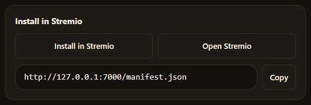

# TTT Sub: AI Subtitle Translator for Stremio

TTT Sub is a Windows app that adds subtitles in your language (Hebrew by default) to
[Stremio](https://www.stremio.com/). When you play a movie or episode it offers a subtitle in your
language. If a ready one exists it is used as it is; otherwise a source subtitle is found,
translated by AI (Gemini, Claude or OpenAI), checked, saved and given to the player. Later plays
are instant.

> It runs only on your own computer (`127.0.0.1`) and is made for Stremio desktop.

> Not affiliated with Stremio. License, third-party code and the Windows "blue window" warning:
> see [LEGAL.md](LEGAL.md).

## Key features

- Translates while you watch; subtitles you already translated open instantly.
- Finds the best source subtitle for the exact video, including anime, and picks the right season
  and episode.
- Uses the subtitle that is inside the video when there is one (exact timing; works when the video
  plays through Stremio's own streaming server, such as torrents), and checks a downloaded
  subtitle's timing against the video's sound, moving it only when sure.
- If a subtitle is off, "Try another subtitle" on the main screen switches to a different source
  and builds the result from that one instead.
- Correct punctuation for Hebrew, Arabic and Persian; speaker names and sound notes are removed.
- Simple setup wizard and a dashboard with a queue, progress and "My subtitles" library.
- Can save a video with the translated subtitle inside (MKV or MP4; desktop app only).
- Updates itself and can start with Windows (tray icon).

## Requirements

- Windows and Stremio desktop
- An AI API key: [Google Gemini](https://aistudio.google.com/apikey) (free tier available),
  Anthropic Claude or OpenAI. The app finds out which one it is when you save the key.
- A free [OpenSubtitles.com](https://www.opensubtitles.com) account and an API consumer key
  (create one at https://www.opensubtitles.com/en/consumers)

## Install

1. Run `Stremio-AI-Subtitle-Translator-Setup-<version>.exe` and wait; the app opens by itself.
   Windows SmartScreen may warn about an unsigned app: choose **More info -> Run anyway**.
2. Follow the setup wizard: paste your AI key, your OpenSubtitles details, pick your language,
   and test the connections.
3. On the last step (or at the bottom of the main screen) click **Install in Stremio**. It opens
   Stremio Web: sign in to the same Stremio account, allow the browser's one-time "access this
   computer" prompt (Chrome) and click Install. Tested in Chrome only.
4. Manual alternative: in Stremio go to Add-ons and paste `http://127.0.0.1:7000/manifest.json`.

More about the installer, tray icon, updates and where your data is kept:
[docs/DETAILS.md](docs/DETAILS.md).

## Quick start

1. Keep TTT Sub running (it can sit in the tray near the clock).
2. Play a movie or episode in Stremio and open the subtitles menu.
3. Pick the entry labelled by this add-on.
4. If it says "TTT Sub: Translating... when it is done, select the subtitle again", wait and
   select it again. A full episode usually takes 1-5 minutes the first time.
5. If something fails, the player says so and the reason is shown in the app.
   See [TROUBLESHOOTING.md](TROUBLESHOOTING.md).

## Privacy

- Subtitle dialogue is sent only to the AI provider that matches your key (Google Gemini,
  Anthropic or OpenAI); subtitle searches go to OpenSubtitles. Quotas, billing and free-tier data-use terms are controlled by those
  providers, not by this add-on.
- Your keys stay on your computer, are never shown again after saving, and are never written to
  logs or put in URLs. Never share your `.env` file or your keys.
- The server listens on `127.0.0.1` only, so the add-on address works on this computer only.
  Logs never contain dialogue by default.

## License

[MIT](LICENSE)

## More

- [TROUBLESHOOTING.md](TROUBLESHOOTING.md) - when something does not work.
- [docs/DETAILS.md](docs/DETAILS.md) - desktop app, installing in Stremio, the screens and
  settings, saving a video, choosing the model.
- [docs/SOURCES-AND-TIMING.md](docs/SOURCES-AND-TIMING.md) - subtitle sources (SubDL, Jimaku,
  the video's own subtitle), source order, timing and sound sync, developer settings.
- [docs/DEVELOPERS.md](docs/DEVELOPERS.md) - running from source, commands, security notes,
  adding a provider, roadmap, posting news, technical feature notes.
- [LEGAL.md](LEGAL.md) - legal notes and credits.
