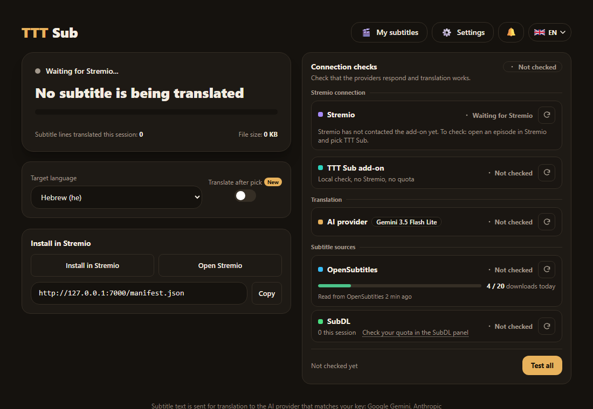
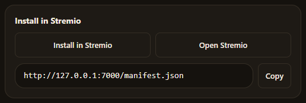

# TTT Sub: AI subtitles for Stremio

TTT Sub is a Windows app that gives you subtitles in your own language (Hebrew by default) in
[Stremio](https://www.stremio.com/). Play something, pick the TTT Sub subtitle, and it finds a
subtitle, translates it with AI and hands it to the player. Next time it is instant.

> Runs only on your own computer. Not affiliated with Stremio. Licence, credits and the Windows
> "blue window" warning: [LEGAL.md](LEGAL.md).

## What you get

- **Translation while you watch.** A full episode takes about 1-5 minutes the first time.
- **The right subtitle.** It looks for the one that fits your exact video (anime included), uses
  the subtitle inside the video when there is one, and fixes the timing when it is sure.
- **A second chance.** If a subtitle is off, press **Try another subtitle** and it builds a new one
  from a different source.
- **Clean Hebrew, Arabic and Persian** (punctuation fixed, speaker names and sound notes removed).
- **Easy to run.** Setup wizard, a dashboard with progress, a **My subtitles** library, tray icon,
  starts with Windows, updates itself.
- A **"Show me what's new"** tour in the bell (top right) after every update.

## What you need

- Windows and the Stremio desktop app.
- An AI key: [Google Gemini](https://aistudio.google.com/apikey) (a free tier exists), Claude or
  OpenAI. The app recognises which one you pasted.
- A free [OpenSubtitles.com](https://www.opensubtitles.com) account and API key
  ([create one here](https://www.opensubtitles.com/en/consumers)).

## Install

1. Download `TTT-Sub-Setup-<version>.exe` from the
   [latest release](https://github.com/TTT-b/stremio-ai-translator/releases/latest) and run it.
   If Windows warns about an unsigned app, choose **More info, then Run anyway**.
2. Follow the setup wizard: paste your keys, pick your language, test the connections.
3. Click **Install in Stremio**, sign in to the same Stremio account in the browser and press
   Install. (Chrome is the tested browser.) Manual way: in Stremio open Add-ons and paste
   `http://127.0.0.1:7000/manifest.json`.

## Use it

1. Keep TTT Sub running (it can sit in the tray by the clock).
2. Play a movie or episode in Stremio and open the subtitles menu.
3. Pick the TTT Sub entry. If it says it is translating, wait and pick it again.

Something not working? See [TROUBLESHOOTING.md](TROUBLESHOOTING.md).

## Privacy

- Subtitle text goes only to the AI provider that matches your key, and searches go to
  OpenSubtitles. Their quotas and terms apply, not ours.
- Your keys stay on your computer and are never shown again, logged or put in URLs.
- The add-on listens on `127.0.0.1` only. Logs contain no dialogue by default.

## More

- [docs/DETAILS.md](docs/DETAILS.md): the app, screens, settings, saving a video, choosing a model.
- [docs/SOURCES-AND-TIMING.md](docs/SOURCES-AND-TIMING.md): subtitle sources, timing and sound sync.
- [docs/DEVELOPERS.md](docs/DEVELOPERS.md): running from source, commands, adding a provider.
- [LEGAL.md](LEGAL.md) and [MIT licence](LICENSE).
